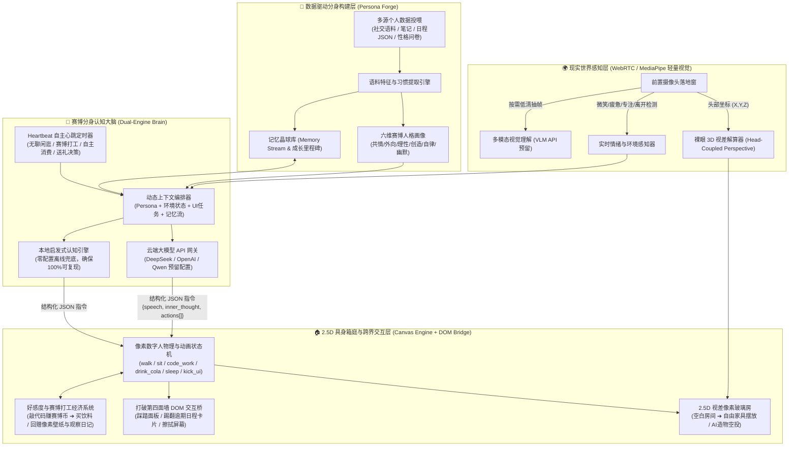

# CyberTwin Box（赛博伴生）—— 数据驱动的成长型赛博分身与2.5D具身智能箱庭系统架构设计

> **参赛赛道**：全国高校 Vibe Coding 开发挑战赛（传智杯）  
> **融合选题方向**：  
> - **方向 8（个人效能与赛博具身智能仿真）**：基于用户个人日常数据（社交发言、笔记、日程），构建包含精致动效的“成长型数字孪生分身”，支持自适应日程冲突调度与跨界 UI 交互。  
> - **方向 9（数据探索与“赛博画像”可视化）**：大模型作为“高级决策器”驱动赛博宠物自适应动作仿真系统，构建多维人格画像与自主经济生态。

---

## 一、 核心设计理念与痛点破局

传统“桌面宠物”或“AI 聊天套壳应用”普遍存在两大痛点：
1. **缺乏真实灵魂与数据根基**：人设依赖一句简单的文本 Prompt，没有从用户的真实个人数据（日常发言语料、读书笔记、作息日程、性格偏好）中生长出来，缺乏陪伴与共同成长的羁绊感。
2. **“有脑无身”或“有身无脑”**：要么只是死板的聊天框，要么只是固定循环播放动画贴图的挂件，无法感知屏幕外主人的状态，也无法与软件内的业务模块（如待办日程、效率看板）产生具身交互。

**《CyberTwin Box（赛博伴生）》** 借鉴了三大开源前沿范式的精髓并进行了工程重塑：
- **Stanford Generative Agents (`reverie` / 斯坦福 AI 小镇)**：引入 `Memory Stream（记忆流） ➔ Reflection（反思提炼） ➔ Action Planning（结构化动作规划）` 闭环，让赛博分身具备自主心跳（Heartbeat）与长期成长记忆。
- **WeClone / Character-LLM（个人数据数字分身构建）**：设计 **Persona Forge（赛博分身数据熔炉）**，从用户投喂的结构化/非结构化数据中提取语言风格、高频口头禅、情绪基调与六维人格雷达画像。
- **VPet / Project AIRI（具身桌宠与好感度经济学）**：采用“大脑决策（LLM Function Calling）+ 身体执行（2.5D 视差像素渲染引擎）”解耦架构，結合前置摄像头裸眼 3D 视差（Head-Coupled Perspective）与赛博打工经济闭环。

---

## 二、 系统全局架构图



---

## 三、 核心模块详细设计

### 1. 数据驱动的“成长型赛博人物分身”构建引擎 (`PersonaForge`)
- **多源数据投喂与解析**：
  - 支持导入或在线编辑三类个人核心数据：**① 日常语料/社交发言样本**、**② 个人笔记/知识碎片**、**③ 每日作息与日程偏好**（支持一键载入多套典型数据集模板，如「熬夜极客学长」、「元气治愈画师」、「严谨效率控研究员」，也支持上传自定义 JSON/TXT/CSV）。
- **人格画像提取与可视化**：
  - 自动统计语料中的句式长度、高频语气词/口头禅、情绪倾向词，实时计算生成 **六维人格雷达图**。
- **五阶段成长体系（Lv.1 初始意识体 ➔ Lv.5 灵魂伴生体）**：
  - 随着数据投喂量、互动次数、共同完成的专注番茄钟与赠送礼物增加，分身等级提升，解锁更深层的共情对话、更高时薪的赛博打工技能，以及主动给主人制造惊喜的能力。

### 2. “大脑决策 + 身体执行”具身动作协议 (`BrainActionProtocol`)
大模型不直接处理像素渲染，而是通过严格约束的 JSON Schema 输出思维链与动作序列：
```json
{
  "inner_thought": "检测到主人已经在电脑前连续工作很久了，而且日程表里有一项逾期任务，我得跑过去踢一下任务卡提醒他，再给他泡杯咖啡。",
  "speech": "喂——再盯着屏幕眼睛要变成赛博灯泡啦！先把右边那个红色的逾期日程清理掉，休息五分钟嘛~",
  "mood": "caring",
  "actions": [
    { "type": "emote", "value": "bulb" },
    { "type": "walk_to", "target": "ui_schedule_dock" },
    { "type": "interact_ui", "target": "overdue_task", "effect": "kick" },
    { "type": "walk_to", "target": "coffee_machine" }
  ]
}
```

### 3. 2.5D 裸眼 3D 视差玻璃房与前置摄像头“落地窗” (`ParallaxRoomCanvas`)
- **Head-Coupled Perspective（头部耦合透视）**：
  - 当开启前置摄像头时，通过轻量面部特征追踪实时计算人脸相对屏幕中心的偏移量 $(\Delta X, \Delta Y, \Delta Z)$；当未开启摄像头时，自动平滑回退至鼠标/陀螺仪视差模式。
  - 房间的后墙、侧墙、地板网格、远景窗外星空与多层家具按深度系数（Z-Depth）产生差异化位移与透视拉伸，在普通 2D 屏幕上呈现出“凹进屏幕内部的立体微缩生态箱”视觉奇观。
- **情绪感知落地窗**：
  - 实时分析用户的状态（微笑度、疲劳度、专注度、是否离开座位），小人会主动跑到玻璃窗前贴脸观察主人并作出反应。

### 4. 从空白小屋到专属家园 + AI 像素造物工坊 (`HomeBuilder & PixelWorkshop`)
- **初始空白小屋**：支持一键切换“极简空白实验室”与“温馨满配小屋”，点击像素素材库即可像《动物森友会》一样在房间网格中自由布置家具（编程工作台、复古红白机、舒适懒人沙发、赛博自动售货机、像素床铺等）。
- **AI 一键生成专属物品**：用户输入任意自然语言（例如：“送她一台发光的复古红白机”、“生成一盆会微笑的赛博仙人掌”），系统通过大模型或程序化像素生成算法即时合成 $16\times16$ / $32\times32$ 像素矩阵贴图，从房间顶部带着降落伞空投到地板上，分身会主动跑去检视并增加好感度。

### 5. 好感度经济学：赛博打工、自主消费与回赠主人 (`CyberEconomy`)
- **自主赛博打工**：当房间内摆放了【编程电脑桌】或【动感发电单车】且主人未主动搭话时，Heartbeat 心跳机制会驱动分身自己走到电脑前噼里啪啦敲代码打工，头顶跳动 `+5 CyberCoin` 金币特效。
- **自主消费欲望**：分身拥有独立的【小人金库】。攒够金币后，分身会自主决定去房间里的自动售货机买一罐像素可乐或能量棒，播放喝饮料冒泡的满足动作。
- **情感羁绊回赠**：当好感度达到里程碑时，分身会用自己打工攒下的钱给主人准备三类可感知的礼物：
  1. **亲手绘制的像素画壁纸**（支持一键导出高清 PNG 到本地桌面）；
  2. **《观察主人日常陪伴日记》**（结合真实互动记录与日程数据生成的温情手账）；
  3. **八音盒治愈轻音乐播放**（当检测到主人疲惫时，调用 WebAudio 合成器自动打开房间音乐机演奏 Lo-Fi 八音盒旋律）。

---

## 四、 API Key 预留与双模容灾机制

为满足开发调试与评委极速复现需求，系统在架构层实现了 **“云端大模型 API + 本地启发式认知引擎”双模无缝切换**：
1. 用户可在界面右上角 **【API 大脑配置中心】** 随时填入 DeepSeek / OpenAI / 通义千问 / Gemini 等兼容接口的 `API Key`、`Base URL` 和 `Model`，支持一键连通性测试。
2. 当 API Key 留空或网络受限时，系统自动启用内置的 **本地启发式分身大脑（Heuristic Persona Engine）**，完整驱动语料风格迁移、思维链可视化、动作序列派发与 AI 像素图矩阵合成，确保任何环境下 100% 零报错运行。
