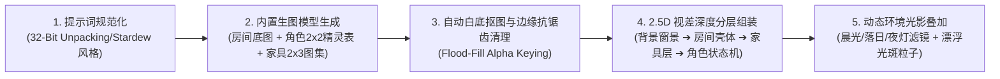

# 治愈系像素美术生成与桌面软件工作流 (Cozy Pixel Art & Desktop Client Workflow)

> **参考标杆项目**：*Spirit City: Lofi Sessions*、*Virtual Cottage*、*Unpacking*（高精度箱庭像素风）、*Stardew Valley*、*VPet（虚拟桌宠模拟器）*、*Stanford Generative Agents*

---

## 一、 为什么摒弃传统“暗黑网页风”，转向“暖阳原木治愈系桌面软件”？

通过对 Steam 与 GitHub 上高口碑陪伴类软件（*Spirit City*、*Virtual Cottage*、*VPet*）的深度调研，真正的“成长型陪伴赛博分身”必须具备以下三大核心体验：
1. **低视觉疲劳的温馨配色（Cozy Sunlit Palette）**：陪伴软件需要数小时挂在桌面旁（Body-Doubling 伴学/伴工模式）。高对比度的暗黑霓虹色容易产生冰冷疏离感，而**暖燕麦奶白（`#FBF6EE`）+ 焦糖原木（`#C89D7C`）+ 鼠尾草绿（`#6B9E78`）+ 蜜桃暖橙（`#E07A5F`）**能瞬间营造出阳光洒进木质书房的治愈感。
2. **精致的 32-Bit 像素艺术资产管线（AI Image Generation + Alpha Chroma-Keying + Layered Sprite Engine）**：
   - 使用内置生图模型生成具有丰富光影细节的 32-bit 像素房间背景、角色多状态精灵图（Sprite Sheet）与等轴测原木/马卡龙家具贴图。
   - 通过自动化像素扣图与网格切片工作流（`scripts/process-pixel-assets.mjs`），将白底精灵图转换为带透明通道（Alpha Channel）的高清像素图层，结合 Canvas 实时光影粒子（阳光尘埃、咖啡热气、八音盒音符、眨眼与呼吸帧）进行混合渲染。
3. **纯正桌面客户端软件形态（Native Desktop App Form Factor）**：
   - 摒弃“从上往下滚的网页布局”，采用 **`100vw × 100vh` 无滚动条全屏桌面软件壳（App Shell）** + **自定义原生标题栏（Titlebar）** + **左侧停靠坞（Dock Rail）**。
   - 支持一键切换 **「完整伴生工作台模式 (Studio Mode)」** 与 **「迷你桌宠挂件模式 (Mini Widget Mode)」**，并提供 Electron 原生配置与一键桌面独立窗口启动器（无浏览器地址栏与标签页干扰）。

---

## 二、 精致像素美术五步工作流 (5-Stage Pixel Art Asset Pipeline)

### 1. 视角与网格统一约束
- **透视标准**：采用正前微俯视 2.5D 娃娃屋箱庭视角（Dollhouse Front-Angled Isometric），确保家具拖拽放置在木地板或编织地毯上时透视自然对齐。
- **渲染清晰度**：所有 Canvas 图层强制开启 `ctx.imageSmoothingEnabled = false`（像素级锐利采样），杜绝模糊拉伸。

### 2. 图层解耦与裸眼 3D 视差映射
- **Layer 0（窗外远景层）**：视差位移系数 `-1.35x`，展示随时间变化的夕阳云海与星辰。
- **Layer 1（原木阳光房间层）**：视差位移系数 `-0.85x`，包含暖色壁纸、仙女串灯、橡木地板与针织地毯。
- **Layer 2（可拖拽交互家具层）**：视差位移系数随 $Y$ 轴深度动态插值，支持点击放置与鼠标自由拖拽。
- **Layer 3（赛博数字人分身层）**：支持多状态精灵切换（待机呼吸、走动寻路、双屏木桌敲代码、捧着草莓汽水喝、云朵垫打盹冒 Zzz、跑去右侧踢便利贴卡片）。
- **Layer 4（前景环境氛围层）**：阳光丁达尔光束、漂浮暖金微尘粒子、八音盒律动音符。
